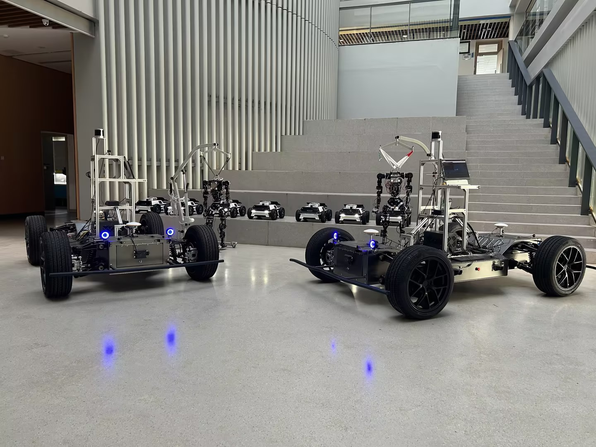
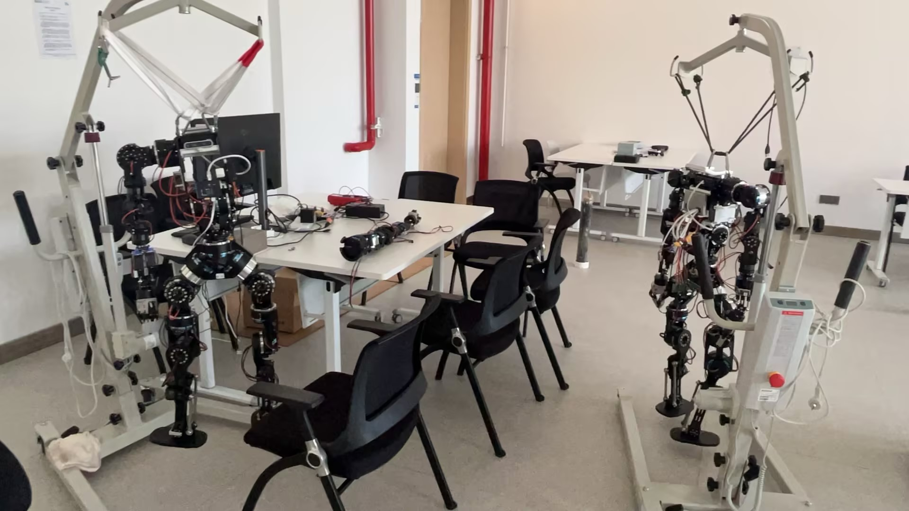
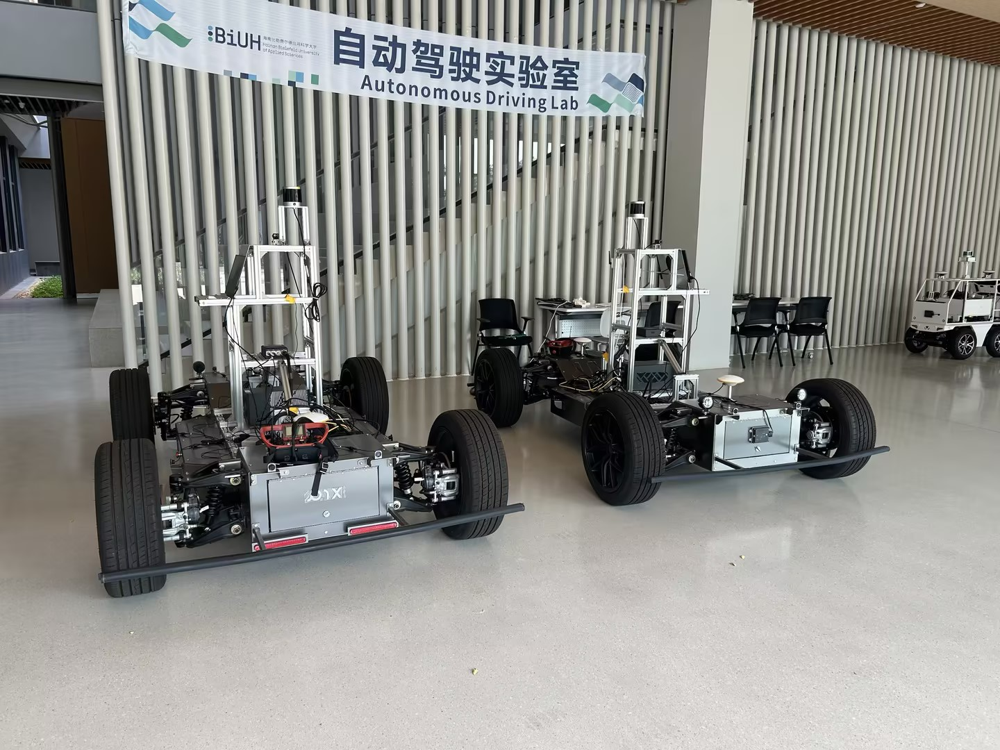
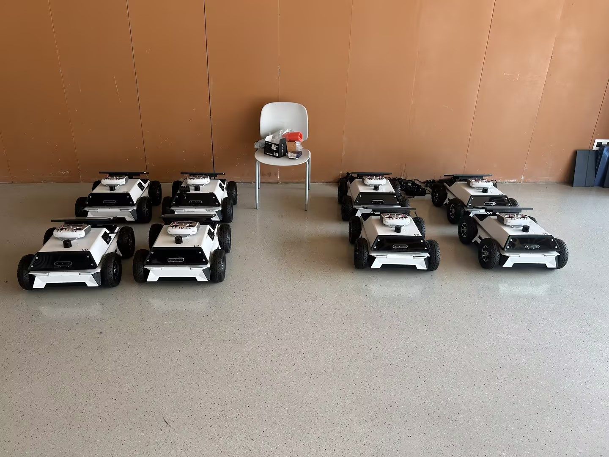
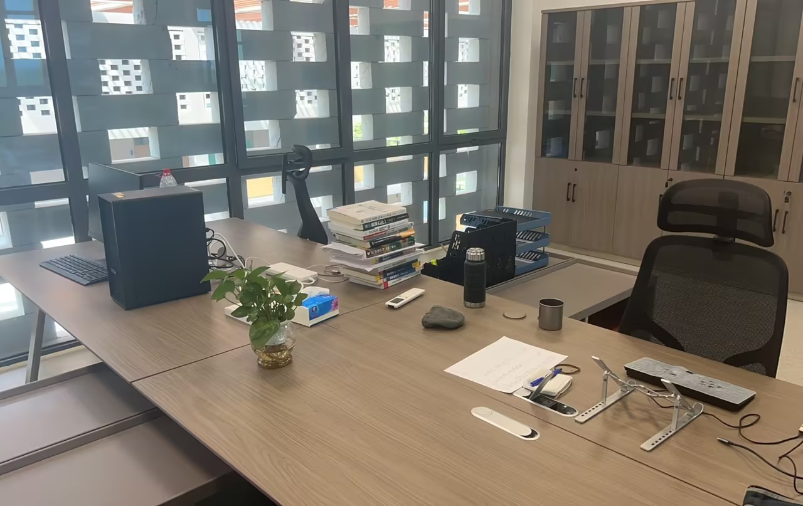

[Back to my homepage](/#robotics-laboratory)

A look at the robotic platforms and working environment at **Hainan Bielefeld University of Applied Sciences**, where I teach robotics and mentor students in robot-learning research.

## Laboratory at a glance

The laboratory environment includes humanoid platforms and wheeled robots of different scales. The photographs below show the platforms and workspace.

*A view of the laboratory's humanoid and wheeled robotic platforms.*

## Humanoid platforms

*Humanoid robots on support frames, alongside laboratory workbenches.*

## Mobile robot and vehicle platforms

  <figure style="margin:0;">
    
    <figcaption style="font-size:0.9em;line-height:1.5;margin-top:12px;">Large wheeled platforms in the Autonomous Driving Lab.</figcaption>
  </figure>
  <figure style="margin:0;">
    
    <figcaption style="font-size:0.9em;line-height:1.5;margin-top:12px;">Small mobile robotic platforms with onboard sensors.</figcaption>
  </figure>

## Working environment

*A shared workspace at Hainan Bielefeld University of Applied Sciences.*

My teaching covers robotics, introductory artificial intelligence, deep learning, Python, and C++. I also mentor students in robot-learning research.

[Teaching and mentoring](/#teaching) · [Research](/#research) · [Contact](/#contact)
