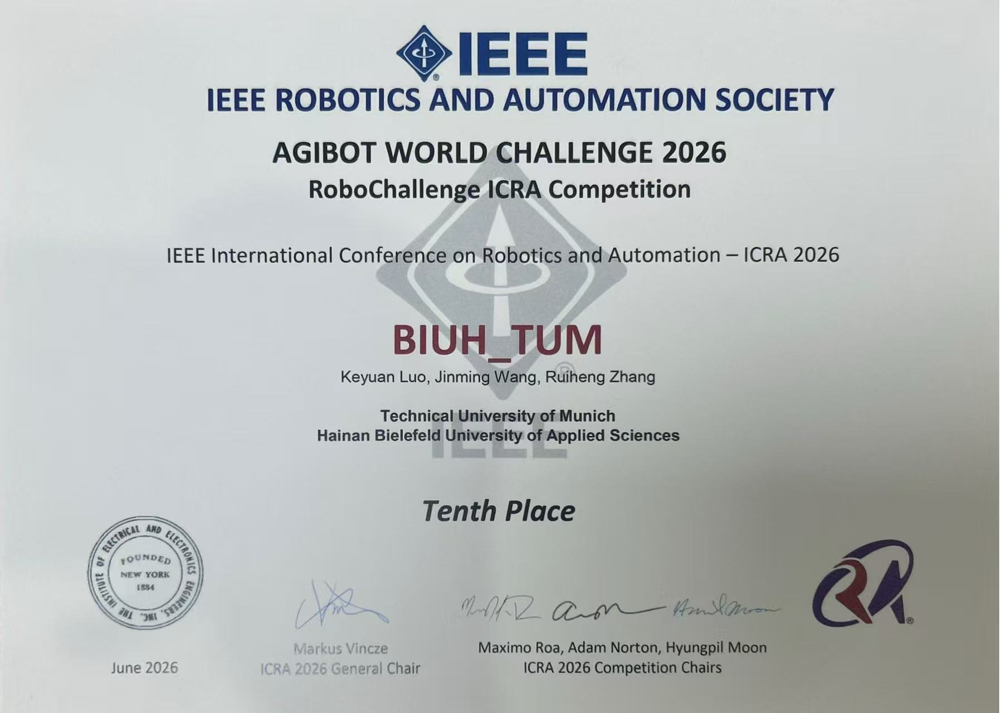
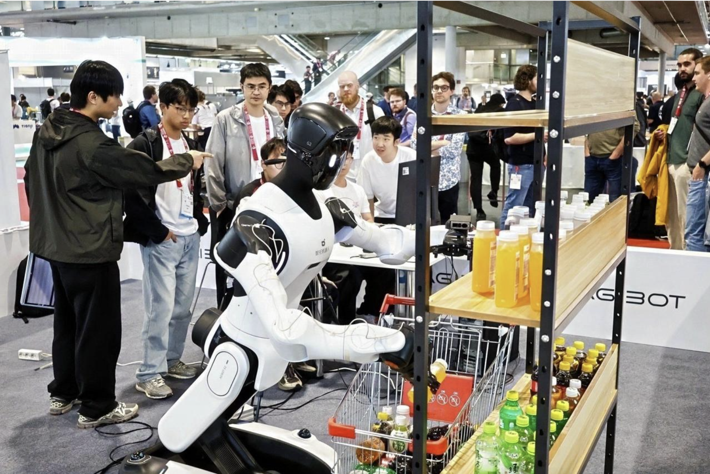

[Back to competitions](/#competitions) · [Task videos](#task-demonstrations) · [Architecture PDF](architecture.pdf) · [Full-resolution diagram](architecture.png) · [Competition result](#competition-result)

## Project overview

As team lead for an AgiBot World Challenge 2026 project, I worked on adapting a pretrained pi0.5-LIBERO policy to the competition's robotic tasks. The project explored LoRA-based adaptation with depth information and iterative evaluation in Genie Sim 3.0.

The architecture shown here describes **Depth-augmented ACoT-VLA**: a visual-language backbone supplies task context, while depth information conditions a coarse-to-fine action-generation pipeline.

## Simulation Task Demonstrations {#task-demonstrations}

Selected simulation recordings of five AgiBot competition tasks, with synchronized head, left-hand, and right-hand camera views. Select a video to play, or use full screen to inspect the manipulation in detail.

  <figure class="agibot-task-card" id="demo-hold-pot">
    <h3 id="title-hold-pot">Bimanual Pot Handling</h3>
    
50 s · Task evaluation passed

    <video controls playsinline preload="none" width="1280" height="1200" poster="/media/agibot/tasks/hold-pot.jpg" aria-labelledby="title-hold-pot" aria-describedby="caption-hold-pot">
      <source src="/media/agibot/tasks/hold-pot.mp4" type="video/mp4">
      <a href="/media/agibot/tasks/hold-pot.mp4">Open the pot-handling video.</a>
    </video>
    <figcaption id="caption-hold-pot">Coordinating both hands to grasp and lift a pot. <a href="/media/agibot/tasks/hold-pot.mp4" aria-label="Open pot-handling video as MP4">Open MP4</a></figcaption>
  </figure>
  <figure class="agibot-task-card" id="demo-open-door">
    <h3 id="title-open-door">Door Opening</h3>
    
27 s · Task evaluation passed

    <video controls playsinline preload="none" width="1280" height="1200" poster="/media/agibot/tasks/open-door.jpg" aria-labelledby="title-open-door" aria-describedby="caption-open-door">
      <source src="/media/agibot/tasks/open-door.mp4" type="video/mp4">
      <a href="/media/agibot/tasks/open-door.mp4">Open the door-opening video.</a>
    </video>
    <figcaption id="caption-open-door">Manipulating the handle and opening the door. <a href="/media/agibot/tasks/open-door.mp4" aria-label="Open door-opening video as MP4">Open MP4</a></figcaption>
  </figure>
  <figure class="agibot-task-card" id="demo-pour-workpiece">
    <h3 id="title-pour-workpiece">Workpiece Pouring</h3>
    
25 s · Task evaluation passed

    <video controls playsinline preload="none" width="1280" height="1200" poster="/media/agibot/tasks/pour-workpiece.jpg" aria-labelledby="title-pour-workpiece" aria-describedby="caption-pour-workpiece">
      <source src="/media/agibot/tasks/pour-workpiece.mp4" type="video/mp4">
      <a href="/media/agibot/tasks/pour-workpiece.mp4">Open the workpiece-pouring video.</a>
    </video>
    <figcaption id="caption-pour-workpiece">Grasping and tilting a container to pour workpieces. <a href="/media/agibot/tasks/pour-workpiece.mp4" aria-label="Open workpiece-pouring video as MP4">Open MP4</a></figcaption>
  </figure>
  <figure class="agibot-task-card" id="demo-retrieve-item">
    <h3 id="title-retrieve-item">Retrieving a Misplaced Item</h3>
    
16 s · Task evaluation passed

    <video controls playsinline preload="none" width="1280" height="1200" poster="/media/agibot/tasks/take-wrong-item-shelf.jpg" aria-labelledby="title-retrieve-item" aria-describedby="caption-retrieve-item">
      <source src="/media/agibot/tasks/take-wrong-item-shelf.mp4" type="video/mp4">
      <a href="/media/agibot/tasks/take-wrong-item-shelf.mp4">Open the item-retrieval video.</a>
    </video>
    <figcaption id="caption-retrieve-item">Removing a misplaced shelf item and placing it in a bin. <a href="/media/agibot/tasks/take-wrong-item-shelf.mp4" aria-label="Open item-retrieval video as MP4">Open MP4</a></figcaption>
  </figure>
  <figure class="agibot-task-card" id="demo-scoop-popcorn">
    <h3 id="title-scoop-popcorn">Scooping Popcorn</h3>
    
53 s · Visually verified

    <video controls playsinline preload="none" width="1280" height="1328" poster="/media/agibot/tasks/scoop-popcorn.jpg" aria-labelledby="title-scoop-popcorn" aria-describedby="caption-scoop-popcorn">
      <source src="/media/agibot/tasks/scoop-popcorn.mp4" type="video/mp4">
      <a href="/media/agibot/tasks/scoop-popcorn.mp4">Open the popcorn-scooping video.</a>
    </video>
    <figcaption id="caption-scoop-popcorn">Scooping popcorn and transferring it into a container. <a href="/media/agibot/tasks/scoop-popcorn.mp4" aria-label="Open popcorn-scooping video as MP4">Open MP4</a></figcaption>
  </figure>

The accompanying run records report successful task evaluations for the first four demonstrations. The popcorn demonstration was verified visually; a valid automated evaluation result was unavailable. These are selected individual runs, not aggregate success-rate measurements.

## How the architecture works

1. **Visual-language context.** RGB views are encoded by SigLIP, and language instructions are embedded into a PaliGemma main LLM adapted with LoRA. Prefix key-value features provide context to the action streams.
2. **Compact depth representation.** A shared DepthExpert processes depth maps and validity masks from head, left, and right views. A two-layer encoder and query pooling produce four tokens per view, giving 12 depth tokens with dimension 256.
3. **Coarse-to-fine actions.** The coarse Gemma expert produces an initial trajectory. The fine stream combines this trajectory with context-derived reasoning features and generates an action chunk. Both action streams receive depth information through separate projections and gated fusion.

**Where adaptation happens.** LoRA is applied in the main LLM; depth is fused into the action-expert inputs. The diagram omits separate noisy-action inputs, time conditioning, and iterative flow-matching updates for clarity.

## Competition result

**Tenth Place - AGIBOT WORLD CHALLENGE 2026, RoboChallenge ICRA Competition (ICRA 2026).**

**Team:** BIUH_TUM  
**Team members:** Keyuan Luo, Jinming Wang, Ruiheng Zhang.

*Competition certificate for team BIUH_TUM, June 2026.*

[View full-size certificate](competition-certificate.jpg)

## Event photograph

*Robot manipulation demonstration at an AgiBot event.*

[Return to my homepage](/)
